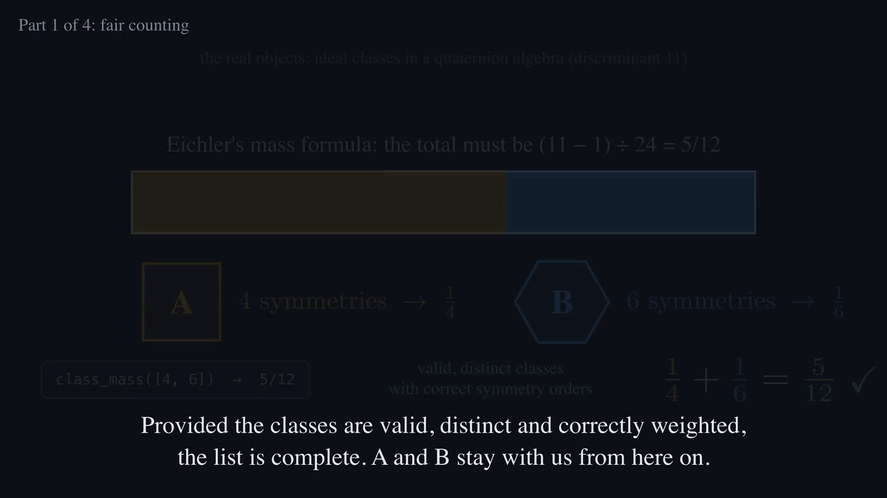
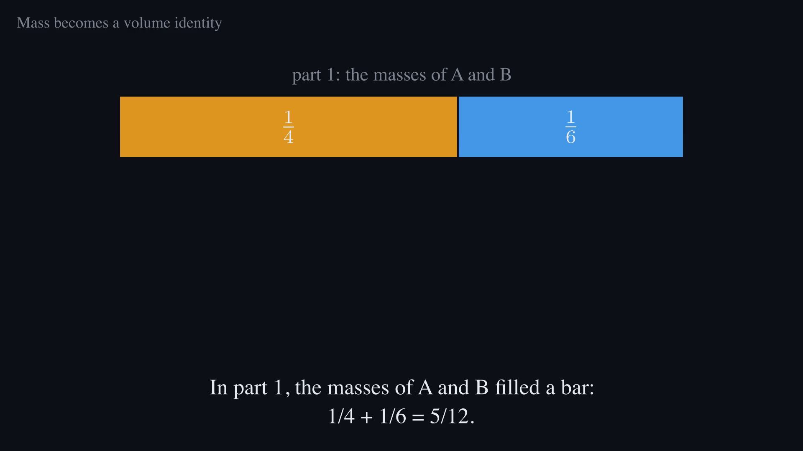

# Hecke mass kernel

This repository implements exact arithmetic for class masses and normalized Hecke coefficients from finite tables. Lean defines both operations and generates shared test fixtures for the native C and Rust libraries. The C integration scaffold also includes an optional RISC-V Vector (RVV) backend for its build probe.

| Path | Purpose |
| --- | --- |
| `docs/` | Mathematical specification, verification scope, and integration guide |
| `docs/manim/` | Explainer animations and their Manim sources |
| `lean/` | Lake project with Lean definitions, proofs, and fixture generator |
| `c/` | CMake project with an installable C library, public header, and optional RVV backend |
| `rust/` | Cargo crate with a native Rust implementation |
| `tests/vectors/` | Shared expected outputs generated by Lean |
| `examples/` | Standalone CMake and Cargo consumers |

## Explainer videos

Two silent, subtitled animations introduce the kernel without assuming any number theory. Click a frame to play the video.

| What the kernel computes (8 min) | Where the proof uses it (2 min) |
| :---: | :---: |
| [](docs/manim/what_the_kernel_computes.mp4) | [](docs/manim/where_the_proof_uses_it.mp4) |
| The two sums, worked on the level-11 example: class mass, prime-2 neighbours, the Brandt matrix, and the eigenvalue −2 that matches an elliptic curve's point count. | The dependency paths from `riemannHypothesis` to `classMass` and `Setup.hecke`, and what the proof does with each. |

[Sources, provenance and rendering instructions](docs/manim/README.md)

## Quick start

Run each check from the repository root. Use Elan with the checked-in toolchain for Lean, CMake 3.16 or newer with a C compiler and GMP development files for C, and Cargo for Rust.

```sh
(cd lean && lake build)

cmake -S c -B build/c
cmake --build build/c
(cd build/c && ctest --output-on-failure)

cargo test --manifest-path rust/Cargo.toml
```

- [Kernel specification](docs/specification.md)
- [How the finite double-coset sums are used in the formalization](docs/primitive-in-the-proof.md)
- [Lean proof scope and fixture generation](docs/verification.md)
- [Phase 02 workbench review and replay coverage](docs/phase-02.md)
- [CMake, Cargo, and RVV integration](docs/integration.md)
