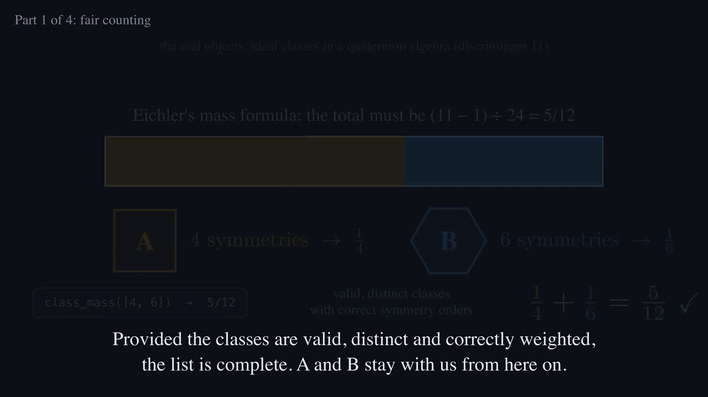
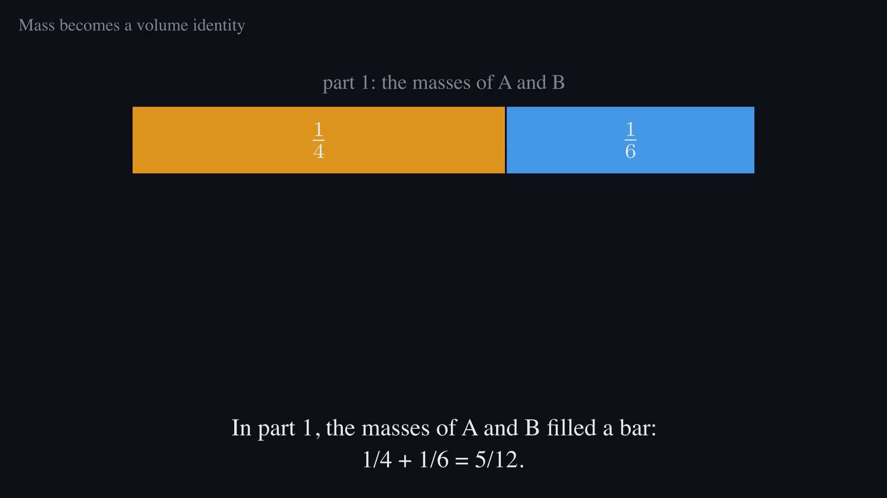

# Animations

Two narrated explainers built with [Manim Community](https://www.manim.community/). They assume no number theory. Each is a silent video with on-screen subtitles.

## 1. What the kernel computes

[](what_the_kernel_computes.mp4)

[what_the_kernel_computes.mp4](what_the_kernel_computes.mp4), about 8 minutes. It ends on the two worked calls that the second video opens on.

The video opens with the result it builds toward: mixing numbers between neighbours and counting solutions of an equation both give −2. Each part then uses what the previous one produced.

| Part | Idea | Worked example |
| --- | --- | --- |
| Fair counting | Weight each pattern by 1 ÷ its symmetries. The total is known in advance, so reaching it certifies that a list of genuine, distinct classes is complete. | 16 corner markings of a square, 6 patterns, total $16/4=4$. Then level 11: $1/4+1/6=5/12=(11-1)/24$. |
| What a neighbour is | A neighbour at the prime $p$ is built by keeping one point in $p$ of a lattice so that a lattice remains. The rules are $ax+by\equiv 0 \pmod p$ up to scaling $(a,b)$, so there are $p+1$ of them. Each neighbour is then sorted into its class, and a loop means a real step that lands back in the same class, which is different from doing nothing. | Three index-2 sublattices of $\mathbb Z^2$: even $x$, even $y$, even $x+y$. A's neighbours are A, B, B and B's are A, A, A. |
| Mixing over neighbours | Each kernel call computes one cell of the Brandt matrix. The masses balance that matrix, which singles out the pattern with mass-weighted average zero. Mixing scales it. | $\left(\begin{smallmatrix}1&2\\3&0\end{smallmatrix}\right)$, $\tfrac14\cdot 2=\tfrac16\cdot 3$, so $3a+2b=0$ gives $(2,-3)\mapsto(-4,6)=-2\,(2,-3)$. |
| The equation | The same number is the baseline minus an elliptic curve's point count, because both sides read the coefficients of one modular form. | $y^2+y=x^3-x^2-10x-20$ has 5 points mod 2 and $2+1-5=-2$, the coefficient of $q^2$ in $q\prod(1-q^n)^2(1-q^{11n})^2$. |
| The software | At run time a workbench supplies finite lists and the kernel returns exact fractions. At development time Lean defines the operations and generates the fixtures that the C and Rust libraries are tested on. | `hecke(u=2/3, q=7, k=0, r=4, [1/2, -2/3])` gives $-1/4$, a row of `tests/vectors/kernel.tsv`. |

The square is a teaching analogy, and the two-dimensional lattice is a model of what happens at one prime: the real objects are lattices in a four-dimensional quaternion algebra, and the $p+1$ count holds at every prime except 11. The scene enumerates the rules and asserts the count for the primes it lists. It also asserts that the balance $\tfrac14 a=\tfrac16 b$ with at most three arrows each way has the single crossing solution $a=2$, $b=3$. Which class each neighbour belongs to is not computed by this repository. The lists A, B, B and A, A, A are the rows of the level-11 matrix $B(2)$ that Gross prints. [Gross, §6](https://wstein.org/papers/bib/Gross-Heights_and_the_Special_Values_of_L-series.pdf) The level-11 data sits in one table at the top of the scene file, and the mass, the matrix, the balance identity, the pattern $(2,-3)$ and its eigenvalue are derived from it and asserted. The scene also counts the curve's points and expands the modular form's product independently and asserts that they agree at the primes shown. It reads the fixture count and the displayed fractional `hecke` row from `tests/vectors/kernel.tsv`. The class-side matrix is computed only at the prime 2; its agreement at other primes is the Eichler–Shimura and Jacquet–Langlands correspondence, which this repository does not compute.

## 2. Where the proof uses it

[](where_the_proof_uses_it.mp4)

[where_the_proof_uses_it.mp4](where_the_proof_uses_it.mp4), about 2 minutes.

The sequel opens on the same two worked calls and follows each into Alpöge's Lean formalization of the Riemann Hypothesis ([source and citations](../references.md)). The level-11 numbers illustrate the arithmetic. The proof applies the same formulas to its own data.

| Definition | Dependency links below `riemannHypothesis` | What the proof does with it |
| --- | ---: | --- |
| `GlobalTheory.Mass.classMass` | 15 | Mass identifies a volume. `volumes_eq_masses_of_unfold` uses a double-coset decomposition to equate a volume with the sum of reciprocal symmetry orders. |
| `GlobalTheory.SeriesTie.Setup.hecke` | 19 | The Hecke sum specifies a readout that survives transport. `HeckeAt` requires a target readout to equal the normalized Hecke sum for every certified local input, and `SerCopy.heckeTieT` carries that condition to the copied setup used in the series construction. |

The wording follows [the written account](../primitive-in-the-proof.md). Both paths are listed in [the dependency paths](../dependency-paths.md), where every step links to the line of the public source that makes it. The size shown at the start, 175,189 Lean files, is the number of `.lean` files in the public mirror's tree at the frozen commit. The network drawn behind it is schematic.

## Rendering

Requires Manim in the repository's `.venv`, a LaTeX installation, and ffmpeg. Run from the repository root.

```sh
uv pip install manim
sh docs/manim/render.sh
```

The script renders each scene at 1920×1080 and 30 fps under `build/manim/`, then writes a compact H.264 MP4 and a poster frame next to its source. `style.py` holds the palette and the `Explainer` scene base, which paces each subtitle by its word count.


## Audio Credits

Music by <a href="https://pixabay.com/users/inspirationnationyt-29865471/?utm_source=link-attribution&utm_medium=referral&utm_campaign=music&utm_content=120404">Daniel Weir</a> from <a href="https://pixabay.com//?utm_source=link-attribution&utm_medium=referral&utm_campaign=music&utm_content=120404">Pixabay</a>
